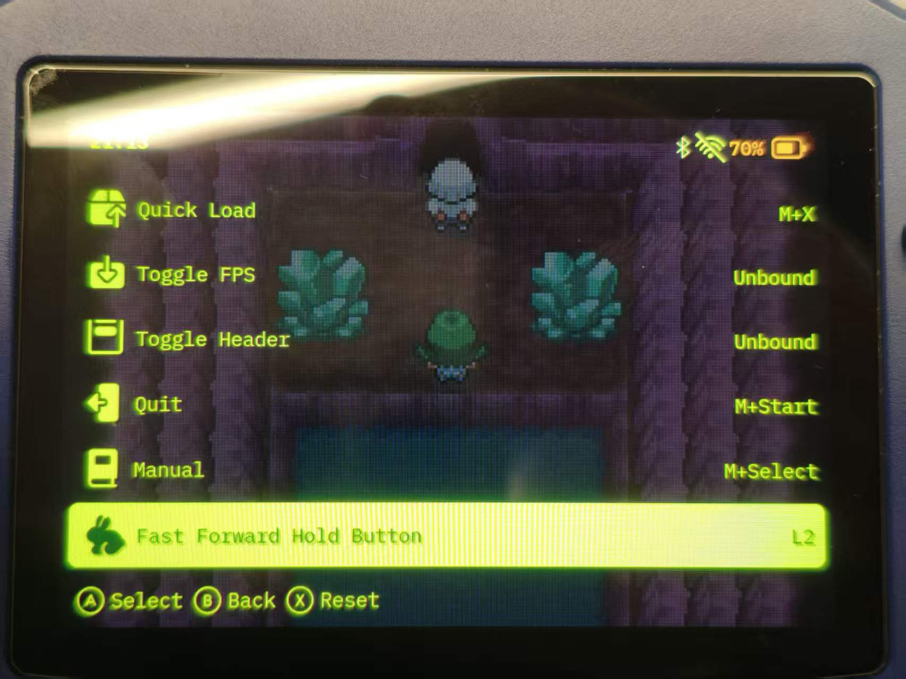

# muOS_pickles_speedup_hotkey

**MustardOS 2606.0 “Andromeda” 的 Pickles（`muxretro`）修改版 —— 独立「快进长按键」**
**Pickles (`muxretro`) patch for MustardOS 2606.0 “Andromeda” — standalone Fast Forward Hold Button**

Bilingual README（中文在前，English below）. Jump to: [简体中文](#zh) · [English](#en) · [Full diff](#full-diff)

<p align="center">
  
</p>

<p align="center"><sub>效果预览 / Preview</sub></p>

---

<a id="zh"></a>

## 简体中文 / Chinese (Simplified)

### 这是什么？/ What is this?

本仓库提供的是 **修改版 `muxretro`**：MustardOS 2606.0 *Andromeda* 用来跑模拟器内容的 libretro 前端（Pickles），以及生成它的源码补丁。

改动只带来一个可见功能：**独立的「快进长按键」**。上游只提供 `MENU + <按钮>` 组合键式快进 —— 想快速跳过一段就得一手按住 MENU、另一手再按第二个键。新键位是单个按键按住即生效，与组合键完全独立，并且可以和已有的 `MENU +` 组合键**共用同一个物理按键**而不破坏原有组合。

| 项目 | 内容 |
|---|---|
| 上游工程 | [MustardOS/frontend](https://github.com/MustardOS/frontend)（GPL-3.0） |
| 上游基线 | tag `2606.0_Andromeda` 之后 3 个提交（`317f9d0d`） |
| 补丁分支 | `feature/single_hotkey_speedup` |
| 产物 | `./muxretro` —— ELF 64 位 LSB，**ARM aarch64**，7,612,664 字节 |
| SHA-256 | `0a6806563d9602768fac66b726c1392be652742a549e8f41a89c88356091b6ac` |
| 掌机安装路径 | `/opt/muos/frontend/muxretro` |
| 许可证 | GPL-3.0，与上游一致 |

### 改了什么？/ What changed?

只重新编译了 `muxretro`。**`libmuxcom.so` 及其它共享库一律不动** —— 这是刻意的设计。

* 新增配置项 `hotkey_ff_hold_button`，与其它热键按钮一起保存，默认**未绑定**。
* 没有新增速度项：新按键直接使用既有的 **Fast Forward Speed**（`2x` / `3x` / `4x` / `8x`，默认 `4x`）。而这一行只有在 **Fast Forward** 不为 `Disabled` 时才会出现 —— 详见[安装](#zh-install)。
* 在 `设置 → 输入 → 热键 → 热键按钮` 里新增一行 **Fast Forward Hold Button**。它不像组合键那样显示 `M+X`，而是只显示按钮名（如 `L2`）；并且**允许和某个 `MENU +` 组合键共用同一个按钮** —— 「自动交换、保持唯一」的规则只作用于组合键。
* 按住该键：开启快进，同时记录当前的快进 / 慢动作状态。
* 松开该键：恢复此前生效的速度状态（本来就在快进就继续快进，本来在慢动作就回到慢动作）。
* 按住期间该键会**从游戏输入中被屏蔽**，不会漏进被模拟的游戏；同时 `fast_forward` / `slow_motion` 两个组合键远程命令会被忽略，避免两边抢速度状态。
* 打开暂停菜单会取消这次长按并恢复记录的状态，菜单不会卡在快进状态。
* 旧配置文件继续可用：设置按具名描述符读写，缺少新键时自动取默认值。在热键按钮子菜单里按 `X` 也会一并复位这一行。

完整源码 diff 见 [完整 diff](#bilingual-changes)。

> 新行的标题与帮助文本是刻意写死的英文字符串。本地化文案放在 `libmuxcom.so` 内的共享语言结构里，往那里加字段会改变 ABI；而本补丁只替换 `muxretro`，两者不匹配就会出现 `%s (%s)` 之类的错误文字。写成静态字符串，单文件替换才能与设备原有库保持 ABI 兼容。

### 硬件支持 / Hardware support

**只支持安伯尼克（Anbernic）H700 平台（ARM64 / AArch64）掌机。**

* CPU：**仅 Anbernic H700**，其它方案一概不支持。
* 作者**只在 RG34xx H（1 GB 内存）上测试过**。其它 H700 型号、其它内存规格、其它厂商的芯片均未验证。
* 二进制用 KNULLI H700 AArch64 Buildroot SDK（GCC 12.3.0）以 `ARM64_A53` 目标编译，**并非** muOS 2606.0 官方 SDK。

### 架构说明与免责声明 / Architecture disclaimer

编译产物理论上就是一个普通的 **ARM64 / AArch64** ELF 可执行文件：

```text
ELF 64-bit LSB, ARM aarch64   （7,612,664 字节）
sha256 0a6806563d9602768fac66b726c1392be652742a549e8f41a89c88356091b6ac
```

如果你胆子够大，并且你的**系统和硬件架构一致**（AArch64、glibc 兼容的 Buildroot 根文件系统、`libmuxcom.so` ABI 相同），可以自行尝试。

**风险完全自负。** 作者**不提供任何担保，也不承担任何责任** —— 变砖、配置损坏、存档丢失、内存卡被清、无限重启或任何其它损失都与作者无关。动手前请务必备份原始 `muxretro`，并准备好回滚步骤（见下）。看不懂步骤就别折腾。

<a id="zh-install"></a>

### 安装 / Install

只替换 `muxretro` 这一个可执行文件。**不要**从本补丁里拷贝 `libmuxcom.so` 或任何其它库 —— 本来就没有，混用版本会让界面文字错乱。

**1. 确认掌机上的真实路径。** 打开 SSH，先启动一个游戏，然后登录并查看运行中的进程：

```sh
pidof muxretro
readlink -f /proc/$(pidof muxretro)/exe
```

预期路径是 `/opt/muos/frontend/muxretro`。如果 `readlink` 输出的不是这个，请把它替换成下面的 `TARGET`。

**2. 上传新二进制。**

```bash
scp muxretro <用户>@<掌机IP>:/tmp/muxretro.new
```

**3. 备份并原子替换。** 先退出游戏，避免文件被占用：

```sh
TARGET=/opt/muos/frontend/muxretro
BACKUP="${TARGET}.bak.$(date +%Y%m%d-%H%M%S)"

cp -p "$TARGET" "$BACKUP"                  # 备份原文件，带时间戳
cp /tmp/muxretro.new "${TARGET}.new"
chmod 755 "${TARGET}.new"
mv -f "${TARGET}.new" "$TARGET"            # 原子替换
sync

echo "备份文件：$BACKUP"
```

如果发现文件系统只读、或路径与预期不符，**请立即停止**，不要尝试 remount 或强行覆盖。

**4. 使用。** 启动游戏，按 `MENU` 打开暂停菜单，路径是：

```text
设置 → 输入 → 热键 → Fast Forward / Fast Forward Speed
                    → 热键按钮 → Fast Forward Hold Button（列表最后一项）
```

> **加速速度来自 `Fast Forward` 设置，要先配好。** 新按键本身没有独立速度：它按同一个「热键」菜单里的 **Fast Forward Speed**（`2x` / `3x` / `4x` / `8x`，默认 `4x`）来加速。而这一行只有在 **Fast Forward** 设为 `Press` 或 `Hold` 时才显示；设为 `Disabled` 时该行会直接从列表里消失（`retro/input/ui_hotkeys.c` 的 `row_can_cycle()`）。所以顺序是：
>
> 1. `设置 → 输入 → 热键 → Fast Forward` → 选 `Press` 或 `Hold`，这样才能解锁速度项。
> 2. `Fast Forward Speed` → 选你想要的加速倍率。
> 3. 进 `热键按钮` → 最下面 `Fast Forward Hold Button` → 选一个按钮（例如 `L2`）。
> 4. 可选：把 `Fast Forward` 再改回 `Disabled`，这样 `MENU +` 组合键不再触发。**新按键仍按刚才设定的倍率工作**，它与组合键互相独立，不要求 `Fast Forward` 保持开启；继续保持开启也完全没问题。

游戏中按住该键即快进，松开回到之前生效的速度状态。设为未绑定即可关闭。注意原有的 `Fast Forward` 仍是 `MENU +` 组合键，它显示 `M+L2` 是正常的，那不是新增项。

即使界面是中文，新增的这一行仍显示硬编码英文名 **Fast Forward Hold Button**（刻意不走共享语言表，见上面的 ABI 说明）。

### 校验与回滚 / Verify and roll back

```sh
sha256sum /opt/muos/frontend/muxretro      # 应为 0a680656...56091b6ac
```

回滚：

```sh
TARGET=/opt/muos/frontend/muxretro
cp -p "$BACKUP" "${TARGET}.restore"        # $BACKUP 用上面打印出的备份路径
chmod 755 "${TARGET}.restore"
mv -f "${TARGET}.restore" "$TARGET"
sync
```

系统升级可能会覆盖手动替换的 `muxretro`，升级后需要重新安装。

### 自行编译 / Building it yourself

完整的编译 / 部署记录（中文）见 `../frontend/retro/docs/build-and-install.md`，要点：

1. H700 SDK：KNULLI `rg35xx-plush-sdk-20240421` → `aarch64-buildroot-linux-gnu_sdk-buildroot.tar.gz`，解压后执行 `./relocate-sdk.sh`，并按老式 `x-tools` 目录布局建软链接。
2. 在 WSL / Linux 里编译（不要在 Windows 工作树里跑 `build.sh`，CRLF 和 shebang 会让它失败）。
3. 编译命令：

```bash
DEVICE=ARM64_A53 XTOOL=/home/<用户>/muOS XDIR=aarch64-buildroot-linux-gnu ./build.sh release
```

4. 产物 `bin/muxretro`，用 `file bin/muxretro` 确认是 `ELF 64-bit ... ARM aarch64`。

包含 `retro/docs/settings.md` 文档更新在内的逐提交级改动，就是 `frontend` 工作树里的 `git diff`，见下。

---

<a id="en"></a>

## English

### What is this?

This repository ships a **patched `muxretro`** binary: the libretro frontend ("Pickles") that MustardOS 2606.0 *Andromeda* uses to run retro content, plus the source patch that produced it.

The patch adds exactly one user-visible feature: a **standalone Fast Forward Hold Button**. Upstream only offers fast forward as a `MENU + <button>` combo, so speeding through a long section means holding MENU with one hand and a second button with the other. The new binding is a single held button, completely independent of the combo hotkeys, and it can share a physical button with an existing `MENU +` combo without breaking it.

| Item | Value |
|---|---|
| Upstream project | [MustardOS/frontend](https://github.com/MustardOS/frontend) (GPL-3.0) |
| Upstream base | tag `2606.0_Andromeda` + 3 commits (`317f9d0d`) |
| Patch branch | `feature/single_hotkey_speedup` |
| Patched artifact | `./muxretro` — ELF 64-bit LSB, **ARM aarch64**, 7,612,664 bytes |
| SHA-256 | `0a6806563d9602768fac66b726c1392be652742a549e8f41a89c88356091b6ac` |
| Device install path | `/opt/muos/frontend/muxretro` |
| License | GPL-3.0, same as upstream |

### What changed?

Only `muxretro` is rebuilt. **`libmuxcom.so` and every other shared library are untouched** — deliberately.

* New setting `hotkey_ff_hold_button`, stored next to the existing hotkey buttons, default **unbound**.
* No new speed setting: the hold button fast-forwards at the existing **Fast Forward Speed** (`2x` / `3x` / `4x` / `8x`, default `4x`). That row is only reachable while **Fast Forward** is not `Disabled` — see [Install](#install).
* New row **Fast Forward Hold Button** in `Settings → Input → Hotkeys → Hotkey Buttons`. Unlike the combos it is shown as a bare button name (`L2`, not `M+L2`), and it is **allowed to share a button** with a `MENU +` combo — the unique-assignment swap rule only applies to the combos.
* While the button is held: fast forward turns on, and the current fast forward / slow motion state is saved.
* On release: the previously active speed state is restored (so if you were already fast forwarding, you stay fast forwarding; if you were in slow motion, you go back to slow motion).
* While held, the button is **suppressed from gameplay input**, so it will not leak into the emulated game. Combo hotkeys (`fast_forward` / `slow_motion` remote commands) are ignored during that time to avoid fighting over the speed state.
* Opening the pause menu cancels the hold and restores the saved state, so the menu never gets stuck in a fast-forward state.
* Existing settings files keep working: settings are read/written by named descriptors, and the new key simply falls back to its default when absent. `X` in the Hotkey Buttons submenu also resets the new row.

Full source diff: [Full diff](#full-diff) / [完整 diff](#bilingual-changes).

> The new row's label and help text are hard-coded English strings on purpose. The localized strings live in the shared language struct inside `libmuxcom.so`; adding a field there would change its ABI, and replacing only `muxretro` would then render garbage such as `%s (%s)`. Keeping the strings static means this single-file drop-in stays ABI-compatible with the stock library.

### Hardware support

**Only Anbernic H700 (ARM64 / AArch64) handhelds.**

* CPU: **Anbernic H700** only — nothing else is supported.
* Tested by the author on **RG34xx H (1 GB RAM)** only. No other H700 model, no other RAM size, no other vendor's SoC has been verified.
* The binary is compiled for `ARM64_A53` with the KNULLI H700 AArch64 Buildroot SDK (GCC 12.3.0), not with an official muOS 2606.0 SDK.

### Architecture disclaimer — read this

The compiled artifact is, in theory, a plain **ARM64 / AArch64** ELF executable:

```text
ELF 64-bit LSB, ARM aarch64   (7,612,664 bytes)
sha256 0a6806563d9602768fac66b726c1392be652742a549e8f41a89c88356091b6ac
```

If you are adventurous and your **system / hardware architecture matches** (AArch64, glibc-compatible Buildroot rootfs, same `libmuxcom.so` ABI), you may try running it on your own device.

**Do this entirely at your own risk.** The author provides **no warranty and accepts no responsibility** for bricked devices, corrupted settings, lost save data, wiped SD cards, bootloops, or any other damage. Back up your original `muxretro` before you touch anything, and be ready to roll back (see below). If you do not fully understand the steps, do not proceed.

### Install

Replace **only** the `muxretro` executable. Do not copy `libmuxcom.so` or any other library from this patch — there aren't any, and mixing versions will break the UI strings.

**1. Confirm the real path on the device.** Enable SSH, start a game, then log in and check the running process:

```sh
pidof muxretro
readlink -f /proc/$(pidof muxretro)/exe
```

The expected path is `/opt/muos/frontend/muxretro`. If `readlink` prints something different, use that path instead of the one below.

**2. Upload the new binary.**

```bash
scp muxretro <user>@<device-ip>:/tmp/muxretro.new
```

**3. Back up and replace atomically.** Exit the game first so nothing is holding the file open:

```sh
TARGET=/opt/muos/frontend/muxretro
BACKUP="${TARGET}.bak.$(date +%Y%m%d-%H%M%S)"

cp -p "$TARGET" "$BACKUP"                  # keep the original, timestamped
cp /tmp/muxretro.new "${TARGET}.new"
chmod 755 "${TARGET}.new"
mv -f "${TARGET}.new" "$TARGET"            # atomic swap
sync

echo "backup: $BACKUP"
```

If the filesystem turns out to be read-only, or the path does not match, **stop**. Do not remount or force anything.

**4. Use it.** Start a game, then open the pause menu with `MENU`. The menu path is:

```text
Settings → Input → Hotkeys → Fast Forward / Fast Forward Speed
                             → Hotkey Buttons → Fast Forward Hold Button  (last row)
```

> **The speed comes from the `Fast Forward` setting — configure it first.** The new button has no speed of its own: it fast-forwards at whatever **Fast Forward Speed** (`2x` / `3x` / `4x` / `8x`, default `4x`) is configured in the same Hotkeys menu. And that speed row is only shown while **Fast Forward** is set to `Press` or `Hold` — with `Disabled` the row disappears from the list (`row_can_cycle()` in `retro/input/ui_hotkeys.c`). So:
>
> 1. `Settings → Input → Hotkeys → Fast Forward` → choose `Press` or `Hold`. This unlocks the speed row.
> 2. `Fast Forward Speed` → pick the multiplier you want for fast forward.
> 3. `Hotkey Buttons` → last row `Fast Forward Hold Button` → pick a button (for example `L2`).
> 4. Optional: set `Fast Forward` back to `Disabled` so the `MENU +` combo no longer triggers. **The hold button keeps working at the speed you picked** — it is independent of the combo and does not need `Fast Forward` to stay enabled. Leaving it enabled is fine too.

In game: hold the button to fast forward, release and the previously active speed state returns. Set the row back to unbound to disable it. The pre-existing **Fast Forward** entry still expects a `MENU +` combo and correctly shows `M+L2` — that is not the new setting.

The new row keeps its hard-coded English name **Fast Forward Hold Button** even in a Chinese UI, because it deliberately avoids the shared language table (see the ABI note above).

### Verify and roll back

```sh
sha256sum /opt/muos/frontend/muxretro      # expect 0a680656...56091b6ac
```

Rollback:

```sh
TARGET=/opt/muos/frontend/muxretro
cp -p "$BACKUP" "${TARGET}.restore"        # $BACKUP = the path printed above
chmod 755 "${TARGET}.restore"
mv -f "${TARGET}.restore" "$TARGET"
sync
```

A system update may overwrite a manually replaced `muxretro`; re-apply after upgrading.

### Building it yourself

Full build/deploy notes (Chinese) live in `../frontend/retro/docs/build-and-install.md`. Summary:

1. H700 SDK: KNULLI `rg35xx-plush-sdk-20240421` → `aarch64-buildroot-linux-gnu_sdk-buildroot.tar.gz`, run `./relocate-sdk.sh`, and create the legacy `x-tools`-style symlink.
2. Build in WSL/Linux (not from a Windows checkout — CRLF and the shebangs break `build.sh`).
3. Build with:

```bash
DEVICE=ARM64_A53 XTOOL=/home/<user>/muOS XDIR=aarch64-buildroot-linux-gnu ./build.sh release
```

4. Artifact: `bin/muxretro`, check with `file bin/muxretro` → `ELF 64-bit ... ARM aarch64`.

The commit-level change list, including the `retro/docs/settings.md` doc update, is `git diff` in the `frontend` working tree; see below.

---

## Changed files / 改动清单

```text
 retro/docs/settings.md    |  9 ++++++---
 retro/input/hotkeys.c     | 28 ++++++++++++++++++++++++++--
 retro/input/ui_hotkeys.c  | 28 +++++++++++++++-------------
 retro/settings/settings.c | 18 ++++++++++++++++--
 retro/settings/settings.h |  5 ++++-
 5 files changed, 67 insertions(+), 21 deletions(-)
```

| File | Change / 改动 |
|---|---|
| `retro/settings/settings.h` | `session_settings_t` gains `hotkey_ff_hold_button`; `enum hotkey_binding` gains `hotkey_binding_fast_forward_hold = hotkey_binding_count` and `hotkey_binding_total_count`.<br>`session_settings_t` 新增 `hotkey_ff_hold_button`；`enum hotkey_binding` 追加 `hotkey_binding_fast_forward_hold = hotkey_binding_count` 与 `hotkey_binding_total_count`。 |
| `retro/settings/settings.c` | Defaults to `HOTKEY_UNBOUND`; registers a `SETTING_CHOICES` descriptor; maps the new binding in `hotkey_button_field_in()`; suppresses the `M+` prefix for it in `session_settings_hotkey_combo_name()`; skips the unique-button swap in `session_settings_set_hotkey_button()` so it may share a button with a combo; resets it in `session_settings_reset_hotkey_buttons()`.<br>默认值设为 `HOTKEY_UNBOUND`；注册 `SETTING_CHOICES` 描述符；`hotkey_button_field_in()` 增加映射；`session_settings_hotkey_combo_name()` 对独立键不输出 `M+`；`session_settings_set_hotkey_button()` 对独立键跳过「按钮唯一」置换，允许与组合键共用；`session_settings_reset_hotkey_buttons()` 一并复位。 |
| `retro/input/hotkeys.c` | Adds `standalone_ff_held` / `standalone_ff_saved_fast_forward` / `standalone_ff_saved_slow_motion`; `hotkeys_task()` detects press/release, saves and restores the speed state, and calls `input_bridge_suppress()` while held; `hotkeys_remote_command()` ignores `fast_forward` / `slow_motion` while the standalone hold is active; `hotkeys_pause_menu_opened()` cancels the hold and restores.<br>新增三个状态变量；`hotkeys_task()` 中检测按下/松开并保存、恢复速度状态，按住时调用 `input_bridge_suppress()` 屏蔽该键；`hotkeys_remote_command()` 在独立快进生效期间忽略 `fast_forward` / `slow_motion`；`hotkeys_pause_menu_opened()` 中取消长按并恢复。 |
| `retro/input/ui_hotkeys.c` | Adds the *Fast Forward Hold Button* row (label, glyph, help) and moves the arrays and bounds checks from `hotkey_binding_count` to `hotkey_binding_total_count`.<br>子菜单新增 *Fast Forward Hold Button* 行（含图标与帮助文本），数组尺寸与 `button_action()` 边界检查由 `hotkey_binding_count` 改为 `hotkey_binding_total_count`。 |
| `retro/docs/settings.md` | Documents the standalone fast-forward hold behaviour.<br>文档补充独立快进长按键的行为说明。 |
| `retro/docs/build-and-install.md` | New (untracked): full H700 build and safe `muxretro` replacement notes.<br>新增（未跟踪）：H700 编译与安全替换 `muxretro` 的完整记录。 |

<a id="full-diff"></a><a id="bilingual-changes"></a>

## Full diff / 完整 diff

`git diff` in `../frontend` (branch `feature/single_hotkey_speedup`, base `2606.0_Andromeda`):

```diff
diff --git a/retro/docs/settings.md b/retro/docs/settings.md
index a2f303e3..1b6a04dc 100755
--- a/retro/docs/settings.md
+++ b/retro/docs/settings.md
@@ -88,8 +88,9 @@ that content's settings; they do not alter core options, controls or save data.
 
 ## Hotkeys
 
-All hotkeys are `MENU + <button>` combos. The Hotkey Buttons submenu changes the second button; choosing one already in use swaps the two assignments so every
-combo remains unique. Press X anywhere in that submenu to restore every button assignment to its default. The defaults are:
+Combo hotkeys are `MENU + <button>`. The Hotkey Buttons submenu changes the second button; choosing one already in use swaps the two assignments so every
+combo remains unique. It also offers an independent Fast Forward Hold Button, which can share a button with a combo. Press X anywhere in that submenu to restore
+every button assignment to its default. The defaults are:
 
 | Combo                           | Action                                                                            |
 |---------------------------------|-----------------------------------------------------------------------------------|
@@ -106,7 +107,9 @@ combo remains unique. Press X anywhere in that submenu to restore every button a
 | MENU (hold, in settings screen) | Peek at the content underneath for a live preview of the current display settings |
 
 Fast Forward and Slow Motion each offer **Disabled**, **Press**, and **Hold**. Press toggles the speed on each combo press. Hold keeps the speed active only
-while both buttons remain down. Value `1` retains the original press-to-toggle behaviour in existing settings files; Hold is stored as `2`.
+while both buttons remain down. Value `1` retains the original press-to-toggle behaviour in existing settings files; Hold is stored as `2`. The optional
+Fast Forward Hold Button is separate: it enables fast forward only while that button is held, then restores the speed mode that was active before it was pressed.
+The button is suppressed from gameplay while held and is unbound by default.
 
 Fast Forward, Slow Motion, and Pause Content each have an independent on screen glyph toggle, so a hotkey can keep working with its indicator hidden. Pausing
 this way won't disturb Fast Forward/Slow Motion. Resuming drops straight back into whichever of the two, if any, was active before the pause. All rumble is
diff --git a/retro/input/hotkeys.c b/retro/input/hotkeys.c
index 11241025..866f0667 100755
--- a/retro/input/hotkeys.c
+++ b/retro/input/hotkeys.c
@@ -28,6 +28,9 @@ static int prev_hotkey[hotkey_binding_count];
 
 static int fast_forward_active = 0;
 static int slow_motion_active = 0;
+static int standalone_ff_held = 0;
+static int standalone_ff_saved_fast_forward = 0;
+static int standalone_ff_saved_slow_motion = 0;
 static int content_paused = 0;
 static int quit_requested = 0;
 static int manual_requested = 0;
@@ -235,12 +238,12 @@ int hotkeys_remote_command(const char *command, const int value) {
         return 1;
     }
     if (strcmp(command, "fast_forward") == 0) {
-        if (!speed_allowed || held_speed) return 0;
+        if (!speed_allowed || held_speed || standalone_ff_held) return 0;
         set_fast_forward(value != 0);
         return 1;
     }
     if (strcmp(command, "slow_motion") == 0) {
-        if (!speed_allowed || held_speed) return 0;
+        if (!speed_allowed || held_speed || standalone_ff_held) return 0;
         set_slow_motion(value != 0);
         return 1;
     }
@@ -271,6 +274,11 @@ void hotkeys_reset(void) {
 
 void hotkeys_pause_menu_opened(const int preserve_speed) {
     update_speed();
+    if (standalone_ff_held) {
+        standalone_ff_held = 0;
+        set_fast_forward(standalone_ff_saved_fast_forward);
+        set_slow_motion(standalone_ff_saved_slow_motion);
+    }
     if (!preserve_speed) {
         fast_forward_active = 0;
         slow_motion_active = 0;
@@ -311,6 +319,22 @@ int hotkeys_task(void) {
     }
 
     const int speed_allowed = !netplay_is_active();
+    const int standalone_ff_button = session_settings.hotkey_ff_hold_button;
+    const int standalone_ff_now = speed_allowed && !menu_held && standalone_ff_button != HOTKEY_UNBOUND
+                                  && (primary_mask & BIT(standalone_ff_button)) != 0;
+
+    if (standalone_ff_now && !standalone_ff_held) {
+        standalone_ff_saved_fast_forward = fast_forward_active;
+        standalone_ff_saved_slow_motion = slow_motion_active;
+        standalone_ff_held = 1;
+        set_fast_forward(1);
+    } else if (!standalone_ff_now && standalone_ff_held) {
+        standalone_ff_held = 0;
+        set_fast_forward(standalone_ff_saved_fast_forward);
+        set_slow_motion(standalone_ff_saved_slow_motion);
+    }
+    if (standalone_ff_held) input_bridge_suppress((mux_input_type) standalone_ff_button);
+
     const int ff_hold = speed_allowed && menu_held && session_settings.hotkey_ff_enabled == hotkey_activation_hold
                         && hotkey_now[hotkey_binding_fast_forward];
     const int slow_hold = speed_allowed && menu_held && session_settings.hotkey_slowmo_enabled == hotkey_activation_hold
diff --git a/retro/input/ui_hotkeys.c b/retro/input/ui_hotkeys.c
index 65b4e444..5c8e5da9 100755
--- a/retro/input/ui_hotkeys.c
+++ b/retro/input/ui_hotkeys.c
@@ -246,24 +246,26 @@ static void cycle_row(const int index, const int direction) {
     }
 }
 
-static const char *button_labels[hotkey_binding_count] = {
-    lang.muxretro.hotkeys_screen.fast_forward,  lang.muxretro.hotkeys_screen.slow_motion,
-    lang.muxretro.hotkeys_screen.pause_content, lang.muxretro.hotkeys_screen.quick_save,
-    lang.muxretro.hotkeys_screen.quick_load,    lang.muxretro.hotkeys_screen.toggle_fps,
-    lang.muxretro.hotkeys_screen.toggle_header, lang.muxretro.quit,
-    lang.muxretro.hotkeys_screen.manual
+static const char *button_labels[hotkey_binding_total_count] = {
+    lang.muxretro.hotkeys_screen.fast_forward,      lang.muxretro.hotkeys_screen.slow_motion,
+    lang.muxretro.hotkeys_screen.pause_content,     lang.muxretro.hotkeys_screen.quick_save,
+    lang.muxretro.hotkeys_screen.quick_load,        lang.muxretro.hotkeys_screen.toggle_fps,
+    lang.muxretro.hotkeys_screen.toggle_header,     lang.muxretro.quit,
+    lang.muxretro.hotkeys_screen.manual,            "Fast Forward Hold Button"
 };
 
-static const char *button_glyphs[hotkey_binding_count] = {"fastforward",  "slowmotion", "pause",
-                                                          "quicksave",    "quickload",  "togglefps",
-                                                          "toggleheader", "quit",       "manual"};
+static const char *button_glyphs[hotkey_binding_total_count] = {"fastforward",  "slowmotion", "pause",
+                                                                 "quicksave",    "quickload",  "togglefps",
+                                                                 "toggleheader", "quit",       "manual",
+                                                                 "fastforward"};
 
-static const char *button_help[hotkey_binding_count] = {
+static const char *button_help[hotkey_binding_total_count] = {
     lang.muxretro.help.hotkeys.button_assignments, lang.muxretro.help.hotkeys.button_assignments,
     lang.muxretro.help.hotkeys.button_assignments, lang.muxretro.help.hotkeys.button_assignments,
     lang.muxretro.help.hotkeys.button_assignments, lang.muxretro.help.hotkeys.button_assignments,
     lang.muxretro.help.hotkeys.button_assignments, lang.muxretro.help.hotkeys.button_assignments,
-    lang.muxretro.help.hotkeys.button_assignments
+    lang.muxretro.help.hotkeys.button_assignments,
+    "Choose a standalone button that fast-forwards only while held. It is suppressed from gameplay while held. Leave unbound to disable."
 };
 
 static void button_value_text(const int index, char *buf, const size_t buf_len) {
@@ -447,7 +449,7 @@ static int button_row_is_action(const int index) {
 }
 
 static void button_action(const int index) {
-    if (index < 0 || index >= hotkey_binding_count) return;
+    if (index < 0 || index >= hotkey_binding_total_count) return;
     pick_open(index);
 }
 
@@ -474,7 +476,7 @@ static const submenu_def buttons_def = {
     .labels = button_labels,
     .glyphs = button_glyphs,
     .help = button_help,
-    .row_count = hotkey_binding_count,
+    .row_count = hotkey_binding_total_count,
     .value_text = button_value_text,
     .row_is_action = button_row_is_action,
     .action = button_action,
diff --git a/retro/settings/settings.c b/retro/settings/settings.c
index 889ae762..3a24bf79 100755
--- a/retro/settings/settings.c
+++ b/retro/settings/settings.c
@@ -58,6 +58,7 @@ static const struct session_settings_t defaults = {
     .speed_persistence = 1,
     .hotkey_ff_enabled = hotkey_activation_press,
     .hotkey_ff_button = mux_input_r1,
+    .hotkey_ff_hold_button = HOTKEY_UNBOUND,
     .hotkey_ff_audio_enabled = 0,
     .hotkey_ff_glyph_enabled = 1,
     .hotkey_slowmo_enabled = hotkey_activation_press,
@@ -361,6 +362,7 @@ static const struct setting_descriptor setting_descriptors[] = {
     SETTING_RANGE(speed_persistence, 0, 1),
     SETTING_RANGE(hotkey_ff_enabled, 0, hotkey_activation_count - 1),
     SETTING_CHOICES(hotkey_ff_button, hotkey_button_values),
+    SETTING_CHOICES(hotkey_ff_hold_button, hotkey_button_values),
     SETTING_RANGE(hotkey_ff_audio_enabled, 0, 1),
     SETTING_RANGE(hotkey_ff_glyph_enabled, 0, 1),
     SETTING_RANGE(hotkey_slowmo_enabled, 0, hotkey_activation_count - 1),
@@ -2187,6 +2189,8 @@ static int *hotkey_button_field_in(struct session_settings_t *settings, const en
             return &settings->hotkey_quit_button;
         case hotkey_binding_manual:
             return &settings->hotkey_manual_button;
+        case hotkey_binding_fast_forward_hold:
+            return &settings->hotkey_ff_hold_button;
         default:
             return NULL;
     }
@@ -2213,6 +2217,10 @@ void session_settings_hotkey_combo_name(const enum hotkey_binding binding, char
         snprintf(buf, len, "%s", lang.muxretro.settings_screen.unbound);
         return;
     }
+    if (binding == hotkey_binding_fast_forward_hold) {
+        snprintf(buf, len, "%s", session_settings_hotkey_button_name(binding));
+        return;
+    }
     snprintf(buf, len, "M+%s", session_settings_hotkey_button_name(binding));
 }
 
@@ -2229,8 +2237,13 @@ int session_settings_set_hotkey_button(const enum hotkey_binding binding, const
     int *field = hotkey_button_field(binding);
     if (!field) return -1;
 
-    // Keep every combo unique. Taking a button another shortcut already uses
-    // leaves that shortcut unbound, so nothing else moves.
+    // The independent fast-forward hold button may intentionally share a button
+    // with a MENU combo; only the combos themselves need unique assignments.
+    if (binding == hotkey_binding_fast_forward_hold) {
+        *field = button;
+        return -1;
+    }
+
     int displaced = -1;
     if (button != HOTKEY_UNBOUND) {
         for (int other = 0; other < hotkey_binding_count; other++) {
@@ -2250,6 +2263,7 @@ int session_settings_set_hotkey_button(const enum hotkey_binding binding, const
 
 void session_settings_reset_hotkey_buttons(void) {
     session_settings.hotkey_ff_button = defaults.hotkey_ff_button;
+    session_settings.hotkey_ff_hold_button = defaults.hotkey_ff_hold_button;
     session_settings.hotkey_slowmo_button = defaults.hotkey_slowmo_button;
     session_settings.hotkey_pause_button = defaults.hotkey_pause_button;
     session_settings.hotkey_quicksave_button = defaults.hotkey_quicksave_button;
diff --git a/retro/settings/settings.h b/retro/settings/settings.h
index c0f6666c..3d30b76d 100755
--- a/retro/settings/settings.h
+++ b/retro/settings/settings.h
@@ -170,6 +170,7 @@ struct session_settings_t {
     int speed_persistence;
     int hotkey_ff_enabled;
     int hotkey_ff_button;
+    int hotkey_ff_hold_button;
     int hotkey_ff_audio_enabled;
     int hotkey_ff_glyph_enabled;
     int hotkey_slowmo_enabled;
@@ -291,7 +292,9 @@ enum hotkey_binding {
     hotkey_binding_toggle_header,
     hotkey_binding_quit,
     hotkey_binding_manual,
-    hotkey_binding_count
+    hotkey_binding_count,
+    hotkey_binding_fast_forward_hold = hotkey_binding_count,
+    hotkey_binding_total_count
 };
 
 #define HOTKEY_UNBOUND (-1)
```

---

## 致谢 / Acknowledgements

- **MustardOS**：感谢 MustardOS 团队做出这么完美的系统，本补丁的每一行都建立在他们的工作之上。官网：**<https://muos.dev>**
- **AI 时代**：感谢 AI 时代，让「改几行代码 + 交叉编译 + 排错 + 写文档」这种小事一个周末就能收尾。
- **我的钱包**：感谢我的钱包，默默承担了主机、掌机、SD 卡，以及无数小时的电费。
- **动手写代码的那位 AI**：感谢 **DeepSeek v4.1 Flash**……或者是 **GPT-6-Luna**。具体是哪个我已经记不清了，反正当时它肯定没抱怨过一句。所以两个一起谢：写过就谢，没写也先存着，下次还用得上。下次我一定在 commit 里认真署名（大概）。

- **MustardOS**: thanks to the MustardOS team for building such a polished system — every line of this patch stands on their work. Website: **<https://muos.dev>**
- **The AI era**: thanks for making “patch a few lines, cross-compile, debug, document it” a weekend-sized task.
- **My wallet**: thanks for quietly paying for the host, the handheld, the SD cards, and all those hours of electricity.
- **Whatever AI actually wrote this**: thanks to **DeepSeek v4.1 Flash** … or possibly **GPT-6-Luna**. I genuinely can't remember which one took the wheel this time — it never once complained either way. So credit goes to both: if it wrote it, well deserved; if it didn't, consider it pre-paid for next round. I will absolutely attribute this properly in the commit message. Probably.

---

## 许可证 / License

修改版前端是 [MustardOS/frontend](https://github.com/MustardOS/frontend) 的衍生作品，遵循 GPL-3.0。补丁源码即上面的 diff，在 `2606.0_Andromeda` 之上打上即可重新编译。

GPL-3.0 — the patched frontend is a derivative work of [MustardOS/frontend](https://github.com/MustardOS/frontend). Source for the patch is the diff above; apply it on tag `2606.0_Andromeda` to rebuild.
